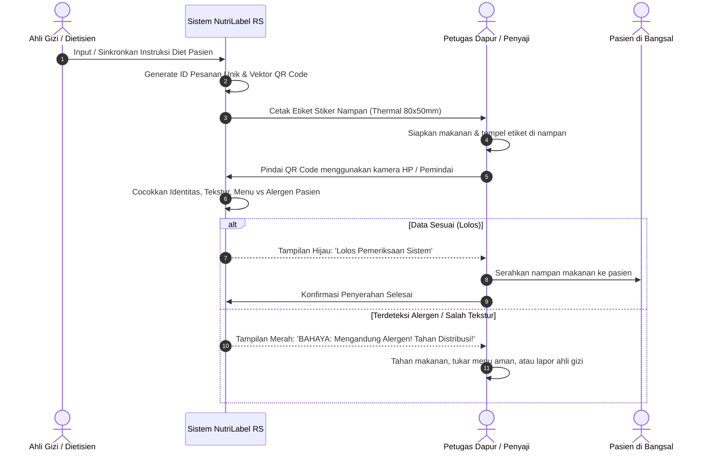

# Dokumentasi Lengkap: Sistem Etiket Makan Pasien Berbasis QR Code
## NutriLabel RS Pro - Solusi Keselamatan Diet & Verifikasi Distribusi Nampan

Dokumen ini disusun berdasarkan konsep resmi etiket makan pasien berbasis QR Code rumah sakit, mencakup arsitektur sistem, spesifikasi format etiket, mekanisme pemindaian kamera, algoritma deteksi alergen, panduan cetak thermal stiker, serta penerapan keahlian desain antarmuka (**Skills: `design-taste-frontend` dan `emil-design-eng`**) untuk menghasilkan antarmuka klinis yang halus, taktil, dan bebas dari kesan *generative AI-slop*.

---

## 1. Latar Belakang & Tujuan Sistem

Dalam tata kelola instalasi gizi rumah sakit, kesalahan penyajian makanan (seperti tertukarnya nampan antar pasien, kesalahan tekstur makanan, atau lolosnya bahan makanan yang menyebabkan alergi fatal) merupakan salah satu insiden keselamatan pasien (*patient safety incident*) yang paling kritis.

### Tujuan Sistem:
1. **Mencegah Makanan Tertukar:** Memastikan setiap nampan makanan memiliki identitas pasien yang jelas, terverifikasi secara digital sebelum diserahkan.
2. **Kesesuaian Tekstur & Jenis Diet:** Memverifikasi bahwa diet pasien (misal: Diet DM, Rendah Garam, Rendah Protein) dan bentuk makanan (Biasa, Lunak, Saring, Cair) sesuai instruksi medis terbaru.
3. **Peringatan Alergi & Pantangan Otomatis:** Memberikan alarm visual dan taktil seketika jika menu makanan yang disiapkan di dapur mengandung bahan yang dilarang bagi pasien.
4. **Verifikasi Terbimbing Petugas:** Membantu petugas distribusi bekerja dengan standar pemeriksaan ganda (*double-check*) yang cepat dan teratur.
5. **Pencatatan Audit Trail:** Merekam bukti digital waktu pemindaian dan petugas yang membagikan makanan sebagai laporan kendali mutu rumah sakit.

---

## 2. Struktur Informasi & Pemisahan Tab Aplikasi

Aplikasi memiliki **4 Tab Mandiri** dengan pemisahan tugas yang tegas:
1. **Tab 1: Buat & Cetak Etiket Nampan:**
   - Kolom Kiri: Form Input Identitas Pasien, Ruangan, Waktu Makan, Jenis Diet, dan Catatan Klinis Internal Petugas.
   - Kolom Kanan: Pratinjau Fisik Etiket Stiker $80\text{ mm} \times 50\text{ mm}$ dan Tombol Aksi Cetak Tunggal / Ekspor CSV.
   - *(Daftar antrean pasien tidak lagi menumpuk di bawah form, melainkan dipindahkan ke Tab 2)*.
2. **Tab 2: Daftar Pasien Terdata:**
   - Database lengkap pasien rawat inap yang telah terdata.
   - Dilengkapi bilah pencarian cerdas (Nama, No. RM, Ruangan, Diet) dan filter waktu makan.
   - Tabel menampilkan: No. RM & ID, Nama Pasien, Ruangan/Bed, Waktu & Tanggal, Diet & Tekstur, Catatan Klinis Alergi, Thumbnail QR SVG, serta Aksi *Buka & Cetak* dan *Hapus*.
3. **Tab 3: Scan Barcode ("Scan disini"):**
   - Pemindai kamera WebRTC nyata dengan dialog izin kamera (*camera permission prompt*), switch kamera, dan input manual barcode USB.
4. **Tab 4: Log Audit Distribusi:**
   - Rekam jejak audit trail digital verifikasi nampan dengan tombol *Ekspor PDF* (laporan resmi RS) dan *Unduh CSV*.

### Kebijakan Privasi Rekam Medis pada Stiker Fisik:
- **Catatan Alergi & Pantangan** disimpan pada sistem sebagai referensi pencocokan keamanan menu oleh scanner.
- **TIDAK DICETAK** pada stiker fisik nampan dan **TIDAK DISIMPAN** dalam teks QR code mentah demi menjaga kerahasiaan rekam medis pasien sesuai standar akreditasi rumah sakit (KARS/JCI).

---

## 3. Alur Kerja Sistem (Workflow Distribusi 7 Langkah)



---

## 4. Algoritma Pencocokan Menu & Alergen (Safety Matcher Engine)

Sistem menggunakan mesin validasi cerdas untuk mencegah kesalahan fatal:

```javascript
// Contoh Logika Safety Matcher
function verifyMealTray(orderData, trayComposition) {
  const issues = [];
  
  // 1. Validasi Tekstur
  if (trayComposition.tekstur !== orderData.tekstur) {
    issues.push({
      type: 'WARNING_TEXTURE',
      severity: 'high',
      message: `Bentuk makanan di nampan (${trayComposition.tekstur}) tidak sesuai instruksi (${orderData.tekstur})!`
    });
  }

  // 2. Validasi Alergen
  const patientAllergies = orderData.alergi.map(a => a.toLowerCase());
  const mealIngredients = trayComposition.bahan.map(b => b.toLowerCase());

  patientAllergies.forEach(allergy => {
    if (mealIngredients.some(ing => ing.includes(allergy))) {
      issues.push({
        type: 'DANGER_ALLERGEN',
        severity: 'critical',
        message: `PERINGATAN BAHAYA: Menu nampan mengandung bahan "${allergy}", sedangkan pasien memiliki catatan ALERGI ${allergy.toUpperCase()}!`
      });
    }
  });

  // 3. Status Keputusan
  if (issues.some(i => i.severity === 'critical')) {
    return { status: 'HOLD_DANGER', issues, allowDistribution: false };
  } else if (issues.length > 0) {
    return { status: 'HOLD_WARNING', issues, allowDistribution: false };
  } else {
    return { status: 'PASS_APPROVED', issues: [], allowDistribution: true };
  }
}
```

---

## 5. Standar Desain Antarmuka: Halus & Anti-Slop (Skills Implementation)

Untuk memastikan aplikasi terasa seperti perangkat lunak profesional kelas enterprise dan bebas dari estetika sintetis (AI-slop):

### A. Panduan Warna & Tipografi (`design-taste-frontend`)
- **Tanpa Gradien Ungu/Neon/Hijau Template:** Menghindari warna hijau template generik dan gradien AI-slop.
- **Palet Higienis Klinis (Clinical Nordic Slate & Porcelain):**
  - Canvas Latar: `#F8FAFC` (Slate Porcelain Pearl).
  - Kartu & Surface: `#FFFFFF` dengan batas presisi `#E2E8F0`.
  - Aksen Primer & Tombol: `#0F172A` (Deep Obsidian Slate) dengan efek *tactile press* `scale(0.975)`.
  - Indikator Lolos: Soft Emerald Badge (`bg-[#ECFDF3] text-[#166534] border-[#BBF7D0]`).
  - Indikator Bahaya: High-Contrast Crimson Rose (`bg-[#FFF1F2] text-[#9F1239] border-[#FECDD3]`).
  - Indikator Bahaya Alergi: Soft Crimson Badge (`bg-[#FEF2F2] text-[#991B1B] border-[#FECACA]`).
- **Font Tabular:** Menggunakan format angka mono-spasi untuk nomor rekam medis dan jam distribusi agar mudah dibaca sekilas oleh petugas yang bergerak cepat di bangsal.

### B. Polish Interaksi & Mikro-Animasi (`emil-design-eng`)
- **Kurva Gerak Alami:** Transisi popup dialog hasil pemindaian menggunakan *crisp ease-out* `cubic-bezier(0.23, 1, 0.32, 1)` dengan durasi ringkas (180ms – 240ms).
- **Umpan Balik Taktil (Tactile Press):** Setiap tombol dan trigger pemindai memiliki umpan balik fisik:
  ```css
  button:active, .pressable:active {
    transform: scale(0.975);
    transition: transform 120ms cubic-bezier(0.23, 1, 0.32, 1);
  }
  ```
- **Pencegahan Animasi Artifisial:** Tidak ada elemen yang membesar dari skala nol (`scale(0)`). Efek dialog masuk dari `scale(0.96) + opacity: 0` menuju `scale(1) + opacity: 1`.

---

## 6. Spesifikasi Format Cetak Etiket (Thermal Roll & A4 Batch)

### Mode A: Stiker Nampan Tunggal (Thermal Printer 80mm × 50mm)
- **Ukuran:** $80\text{ mm} \times 50\text{ mm}$ (standar printer stiker Xprinter / TSC / Zebra rumah sakit).
- **Konten:** Nama, No. RM, Ruangan, Jadwal Makan, Jenis Diet, Tekstur, Baris peringatan Alergi dengan highlight kontras, dan QR Code di sisi kanan ($32\text{ mm} \times 32\text{ mm}$).
- **Margin:** $2\text{ mm}$ sekeliling, tanpa header/footer peramban (`@page { margin: 0; size: 80mm 50mm; }`).

### Mode B: Lembar Cetak Massal A4 (Batch Sticker Sheet)
- **Ukuran:** Kertas stiker A4 standar ($210\text{ mm} \times 297\text{ mm}$).
- **Tata Letak:** Grid 2 kolom $\times$ 6 baris (12 etiket per lembar) dilengkapi garis bantu potong halus (*cutting guides*).

---

## 7. Integrasi Menjadi Ekosistem Terpadu (Hospital Nutrition Suite)

Dengan hadirnya modul etiket ini, sistem gizi rumah sakit kita kini memiliki alur hulu ke hilir yang utuh:

1. **NutriKlinis e-PAGT (`index.html`):** Asuhan gizi klinis, diagnosis otomatis PES, dan preskripsi diet dokter/dietisien.
2. **NutriStok RS (`dapur-gizi.html`):** Pengelolaan stok bahan makanan, perhitungan porsi massal, dan mutasi dapur FIFO.
3. **NutriLabel RS (`etiket-makan.html`):** Pencetakan etiket nampan berbasis QR Code dan verifikasi pemindai kamera bebas salah diet di bangsal rawat inap.
