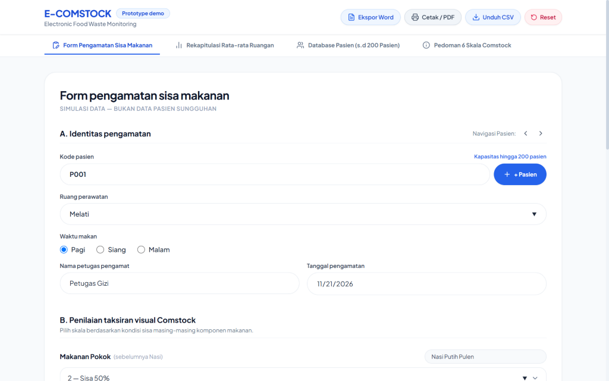
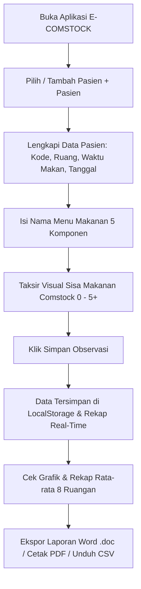

# 🏥 E-COMSTOCK — Electronic Food Waste Monitoring System

<div align="center">



**Sistem Digital Pemantauan & Evaluasi Taksiran Visual Sisa Makanan Pasien Rawat Inap**  
*Sesuai Standar Pelayanan Minimal (SPM) Kemenkes RI No. 129/Menkes/SK/II/2008 (&le; 20%)*

[](https://ecomstock-eta.vercel.app)
[](https://ecomstock-eta.vercel.app)
[](https://ecomstock-eta.vercel.app)
[](LICENSE)

[🌐 Buka Live Demo Aplikasi](https://ecomstock-eta.vercel.app) • [📖 Panduan Penggunaan](#-panduan-penggunaan-sop-enumerator) • [📊 Standar SPM Kemenkes](#-standar-pelayanan-minimal-spm-gizi) • [📑 Fitur Ekspor](#-fitur-unggulan)

</div>

---

## 📌 Sekilas Tentang E-COMSTOCK

**E-COMSTOCK** (*Electronic Food Waste Monitoring*) adalah aplikasi berbasis web modern yang dirancang khusus untuk Instalasi Pelayanan Gizi & Dietetik Rumah Sakit. Sistem ini menggantikan pencatatan manual berbasis formulir kertas dengan taksiran visual digital berbasis **Metode Comstock 6 Skala Taksiran Visual**.

Dengan sistem ini, petugas enumerator gizi dan ahli gizi (*dietitian*) dapat:
1. Memantau daya terima makanan pasien secara cepat, akurat, dan non-invasif.
2. Menghitung persentase rata-rata sisa makanan dan konsumsi secara *real-time*.
3. Merekapitulasi capaian indikator SPM per ruangan rawat inap (*Melati, Mawar, Anggrek, Dahlia, Teratai, Flamboyan, ICU, VIP*).
4. Menghasilkan laporan audit mutu gizi berstandar akreditasi (**STARKES/KARS**) dalam format **Microsoft Word (.doc)** lengkap dengan kop surat dan kolom tanda tangan resmi, serta format cetak **PDF** dan **CSV**.

---

## 🌟 Fitur Unggulan

### 1. 📋 Taksiran Visual Comstock 6 Skala Otomatis
Menggunakan standar baku 6 skala taksiran visual Comstock yang umum digunakan dalam riset gizi klinis rumah sakit:
- **0** : Sisa 0% (Makanan habis dikonsumsi 100%)
- **+** : Sisa 25% (Makanan dikonsumsi 75%)
- **++** : Sisa 50% (Makanan dikonsumsi 50%)
- **+++** : Sisa 75% (Makanan dikonsumsi 25%)
- **++++** : Sisa 95% (Hanya tersisa sedikit suapan / dikonsumsi 5%)
- **+++++** : Sisa 100% (Makanan utuh tidak dimakan / dikonsumsi 0%)

Formula komputasi otomatis menghitung rata-rata sisa 5 piring saji per pasien:
$$\text{Rata-rata Sisa (\%)} = \frac{\text{Sisa Pokok} + \text{Sisa Hewani} + \text{Sisa Nabati} + \text{Sisa Sayur} + \text{Sisa Buah}}{5}$$

### 2. 🍲 Fleksibilitas 5 Komponen Menu Makanan
Tidak terbatas pada nasi, aplikasi mendukung berbagai variasi makanan pokok (nasi putih, nasi tim, bubur saring/halus) dan nama menu spesifik:
- **Makanan Pokok** *(cth: Nasi Tim Kaldu / Bubur Beras)*
- **Lauk Hewani** *(cth: Ayam Suwir Ungkep / Semur Daging)*
- **Lauk Nabati** *(cth: Tahu Bacem / Tempe Mendoan)*
- **Sayur** *(cth: Sop Oyong Wortel / Sayur Bening Bayam)*
- **Buah** *(cth: Pisang Ambon / Pepaya Potong)*

### 3. 👥 Kapasitas Hingga 200 Pasien Rawat Inap
- Dilengkapi tombol **`+ Pasien`** dinamis untuk menambah rekam observasi baru secara instan.
- Pencarian dan pemilihan cepat kode pasien (`P001`, `P002`, dst.) dengan tombol navigasi *Next/Previous*.
- Tabel basis data interaktif dengan fitur filter per ruangan, per waktu makan, dan tombol hapus/reset.

### 4. 🏥 Rekapitulasi Rata-rata 8 Ruangan Rawat Inap
Pemetaan evaluasi otomatis untuk seluruh ruang perawatan utama:
- 🌸 **Ruang Melati**
- 🌹 **Ruang Mawar**
- 🪻 **Ruang Anggrek**
- 🌺 **Ruang Dahlia**
- 🪷 **Ruang Teratai**
- 🌷 **Ruang Flamboyan**
- 🩺 **Ruang ICU**
- ⭐ **Ruang VIP**

Setiap ruangan langsung diklasifikasikan dengan badge:
- **Memenuhi SPM (&le; 20%)**: Rata-rata sisa makanan ruangan di bawah atau sama dengan ambang batas batas aman Kemenkes.
- **Melebihi SPM (> 20%)**: Alarm visual untuk evaluasi menu, toleransi pasien, atau konsultasi dokter penanggung jawab pelayanan (DPJP).

### 5. 📊 Grafik Analisis Komponen (Chart.js)
Grafik batang interaktif (*Interactive Bar Chart*) berwarna *medical blue* yang membandingkan persentase sisa di antara kelima komponen makanan untuk mengetahui jenis hidangan mana yang paling sering tidak dihabiskan oleh pasien.

### 6. 📄 Ekspor Dokumen Resmi Rumah Sakit
- **Ekspor Dokumen Word (.doc)**: Menghasilkan berkas Microsoft Word lengkap dengan Kop Surat Resmi RSUD, tabel rekapitulasi ruangan, rincian pasien, dan lembar legalisasi Kepala Instalasi Gizi & Enumerator.
- **Cetak / PDF Khusus A4**: Dilengkapi CSS *print stylesheet* berstandar dokumen rekam medis rumah sakit.
- **Unduh Dataset CSV**: Format *comma-separated values* siap olah untuk analisis statistik di Microsoft Excel, SPSS, atau Google Sheets.

---

## 🎯 Standar Pelayanan Minimal (SPM) Gizi

Berdasarkan **Keputusan Menteri Kesehatan RI No. 129/Menkes/SK/II/2008** tentang Standar Pelayanan Minimal Rumah Sakit:

| Indikator Mutu Gizi | Standar Capaian | Status di E-COMSTOCK |
| :--- | :---: | :---: |
| **Sisa Makanan yang Tidak Dihabiskan oleh Pasien** | **&le; 20%** | Badge Biru Terang `Sesuai SPM (≤20%)` |
| **Sisa Makanan Kritis / Tidak Ditoleransi** | **> 20%** | Badge Merah Lembut `Melebihi SPM (>20%)` |

> [!IMPORTANT]
> Sisa makanan > 20% mengindikasikan risiko malnutrisi rumah sakit (*hospital malnutrition*), pemborosan biaya pengolahan bahan makanan (*food waste cost*), dan perlunya penyesuaian bentuk makanan atau diet khusus pasien.

---

## 🛠️ Arsitektur & Teknologi

E-COMSTOCK dibangun dengan arsitektur modern yang ringan, cepat, dan tidak memerlukan instalasi runtime yang berat (*Zero-Build Architecture*):

- **Struktur & Tata Letak**: HTML5 Semantic & Modern CSS Grid / Flexbox
- **Framework Styling**: [Tailwind CSS v3](https://tailwindcss.com/) dengan palet warna *Light Medical Blue Aesthetic*
- **Tipografi**: Google Fonts ([Plus Jakarta Sans](https://fonts.google.com/specimen/Plus+Jakarta+Sans) & Inter)
- **Ikonografi Medis**: [Lucide Icons](https://lucide.dev/)
- **Visualisasi Data**: [Chart.js 4.x](https://www.chartjs.org/)
- **Penyimpanan Lokal**: Browser `LocalStorage` API (Otomatis tersimpan lokal, tahan *refresh*, dan bebas kebocoran data)
- **Deployment & Hosting**: [Vercel](https://vercel.com/) Edge Network

---

## 🚀 Panduan Menjalankan Secara Lokal

Aplikasi ini bersifat *static single-page application* sehingga dapat langsung dijalankan tanpa perlu instalasi `npm install` atau build step:

### Opsi 1: Menjalankan Langsung di Browser
Cukup unduh atau *clone* repository ini, lalu buka file `index.html` dengan peramban (Chrome, Edge, Firefox, Safari):
```bash
git clone https://github.com/panjiprasetyaa/ecomstok.git
cd ecomstok
# Buka file index.html di browser Anda
```

### Opsi 2: Menggunakan Local Development Server
```bash
# Menggunakan Python (Port 8089 atau port bebas lainnya)
python -m http.server 8089

# Atau menggunakan npx serve
npx serve .
```
Akses di browser pada alamat `http://localhost:8089`.

---

## 📖 Panduan Penggunaan (SOP Enumerator)



1. **Memilih / Menambah Pasien**:
   - Pilih kode pasien dari dropdown (misal `P001 - Ruang Melati`).
   - Atau klik tombol **`+ Pasien`** di samping header formulir untuk membuat kode baru secara berurutan.
2. **Mengisi Identitas Pengamatan**:
   - Tentukan **Ruang Perawatan** (Melati s/d VIP).
   - Tentukan **Waktu Makan** (Pagi, Siang, atau Sore).
   - Masukkan **Tanggal** dan **Nama Petugas Enumerator**.
3. **Mengisi Nama Menu & Skala Comstock**:
   - Ketikkan menu yang disajikan untuk masing-masing piring (Makanan Pokok, Lauk Hewani, Lauk Nabati, Sayur, Buah).
   - Klik kartu skala taksiran visual (0, +, ++, +++, ++++, +++++).
   - Kartu yang terpilih akan berubah warna menjadi biru dengan indikator persentase sisa & porsi yang dimakan.
4. **Menyimpan & Melihat Hasil**:
   - Klik tombol **`Simpan Observasi Pasien`**.
   - Beralih ke tab **`Rekapitulasi Rata-rata Ruangan`** untuk melihat evaluasi SPM seluruh bangsal.
   - Beralih ke tab **`Database Pasien (s.d 200)`** untuk melihat tabel komprehensif.
5. **Mencetak & Ekspor Laporan**:
   - Klik **`Ekspor Word`** untuk mengunduh laporan resmi yang siap ditandatangani.
   - Klik **`Cetak / PDF`** untuk cetak langsung ke printer atau simpan sebagai PDF A4.
   - Klik **`Unduh CSV`** untuk pengolahan spreadsheet.

---

## 📂 Struktur Berkas Repository

```
ecomstok/
├── index.html                   # Aplikasi Utama E-COMSTOCK (Dashboard & Formulir)
├── vercel.json                  # Konfigurasi deployment & clean URLs Vercel
├── README.md                    # Dokumentasi lengkap proyek
├── DOKUMENTASI_ECOMSTOCK.md      # Panduan teknis & spesifikasi sistem
├── assets/                      # Aset visual & gambar demonstrasi
│   ├── ecomstock-preview.png    # Preview tampilan aplikasi E-COMSTOCK
│   └── ...                      # Aset ilustrasi penunjang
└── .gitignore                   # Konfigurasi berkas yang diabaikan git
```

---

## 🔒 Privasi Data Pasien & Keamanan

Sistem E-COMSTOCK dirancang dengan prinsip **Privacy by Design**:
- Seluruh data pengamatan disimpan secara lokal pada penyimpanan peramban (*browser LocalStorage*).
- Tidak ada data rekam medis pasien yang dikirim ke server pihak ketiga tanpa otorisasi petugas.
- Pembersihan atau pengembalian data simulasi awal dapat dilakukan kapan saja melalui tombol **`Reset`**.

---

## 👥 Pengembang & Lisensi

- **Institusi**: Instalasi Pelayanan Gizi & Dietetik Rumah Sakit
- **Standard**: Pedoman Pelayanan Gizi Rumah Sakit (PGRS) Kemenkes RI
- **Platform**: Web Static Application
- **Lisensi**: [MIT License](LICENSE) &copy; 2026. Bebas digunakan dan dikembangkan untuk keperluan institusi kesehatan dan penelitian gizi klinis.

<div align="center">
  <sub>Dibangun dengan dedikasi untuk peningkatan mutu pelayanan gizi & pencegahan malnutrisi rumah sakit di Indonesia.</sub>
</div>
